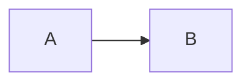

# Static portfolio and blog (v2)

A fast static site generated from the GitLab/Obsidian content repository. The browser receives semantic HTML, CSS, and small vanilla JavaScript modules. Runtime writes (comments, likes, leaderboard) go back into the same vault via server-side GitLab APIs — no Supabase or other database.

## Local preview

```bash
npm install
npm run dev
```

`npm run dev` uses built-in demo content, so GitLab credentials are not required.

To preview your **real posts** while writing in Obsidian (read-only, nothing is committed or pushed):

```bash
npm run dev:local      # builds from ../blog (your vault checkout) and serves it
node build.mjs --local="D:/path/to/vault"   # or point at another folder
```

> The preview server's `/api/likes` and `/api/comments` talk to the **real** GitLab repo (and Telegram) using your `.env`, so a Like or comment sent from the preview is a real one.

## Tests

```bash
npm test
```

Uses Node’s built-in test runner (`node:test`). Content-repo review tests:

```bash
cd ../blog
python -m unittest tests/test_process_review.py
```

## Production build

Copy `.env.example` to `.env`. Required:

- `GITLAB_PROJECT_ID`
- `GITLAB_TOKEN` — **read + write** on the content project (`api` scope, or `read_repository` + `write_repository`). Server-only; do not use `NEXT_PUBLIC_*` for a write token.
- `GITLAB_REF` (defaults to `main`)
- `SITE_URL`
- `GITLAB_WEBHOOK_SECRET` / `VERCEL_DEPLOY_HOOK_URL` (CMS auto-rebuild)

Optional:

- `TELEGRAM_BOT_TOKEN` / `TELEGRAM_CHAT_ID` — get a Telegram message for every new like and comment (see below)
- `SITE_CACHE_REF` (default `site-cache`) — branch for prior HTML used by incremental builds
- `SKIP_SITE_CACHE=1` — skip uploading cache during build

```bash
npm run build
```

Output is `dist/`.

The build also optimizes output for delivery:

- Images in `public/images/` are converted to AVIF/WebP variants (640w/1280w) with a resized JPEG/PNG fallback; templates emit `<picture>`
- CSS and JavaScript are minified, HTML whitespace outside `<pre>`/`<textarea>`/`<script>`/`<style>` is collapsed
- Requires the `sharp` and `esbuild` devDependencies (installed by `npm install`)

## Vercel

- **Root Directory:** repository root
- **Build Command:** `npm run build`
- **Output Directory:** `dist`
- Env vars: same as `.env.example` (token stays on the server / build)

## Content format (GitLab vault)

- `content.json` — portfolio, projects, social links
- `details.json` / `pages/` / `tags/` — listings
- post `*.md` — YAML front matter + markdown
- `comments/approved/{slug}.json` — published comments
- `likes/{slug}.json` — like counts + device ids
- `leaderboard.json` — type-race scores
- `rebuild-manifest.json` — dirty posts / comment pages / full flag
- `Review/` — Obsidian inbox for moderation

### Obsidian review loop

1. Open `Review/Home.md`
2. Open a pending note under `Review/Pending/`
3. Set frontmatter `decision:` to `accept` or `reject`
4. Commit & push with Obsidian Git

Pre-commit runs `process_review.py` then `generate_repo_structure.py`.

### Quran verses

Write the reference; the Arabic (Uthmani script) and an English translation are fetched at build time from [api.alquran.cloud](https://alquran.cloud/api) (Tanzil text) and cached in `.cache/quran.json`:

````markdown
```quran
2:255
```
````

| You write | You get |
|-----------|---------|
| `2:255` | one verse |
| `18:1-5` | a range (up to 40 verses), numbered with ornate verse-end markers |
| `translation: en.asad` | another [edition](https://api.alquran.cloud/v1/edition?format=text&type=translation) (default `en.sahih`; `none` for Arabic only) |
| Arabic lines under the reference | your own Arabic replaces the fetched text |
| non-Arabic lines under the reference | your own translation replaces the fetched one |

Posts written in Arabic default to no translation. The card links to Quran.com and has a Copy button. In production (`npm run build`) the build **fails** if a verse can't be fetched, so a post is never published with a missing verse; local/demo builds fall back to a "Read on Quran.com" card instead.

### Quotes, hadith, callouts and references

```markdown
> The unexamined life is not worth living.
> — Socrates, *Apology*              <- last line starting with — becomes the attribution

> [!hadith] Sahih al-Bukhari 1      <- title is shown as the source
> إنما الأعمال بالنيات

> [!tip] Optional title              <- also: note, info, warning, important, example, quote, dua
> Obsidian-style callout.

Some claim.[^1] Another.[^src]

[^1]: A reference shown in a "References" list at the end, with back-links.
[^src]: Footnotes can be named, too.
```

Arabic inside an English post is wrapped automatically (right font and direction), and a paragraph that starts in Arabic reads right-to-left. Articles with three or more `##`/`###` headings get an "In this article" contents box and `#` deep-link anchors.

### Mermaid and charts

In any post:

````markdown


```chart
{ "type": "bar", "data": { "labels": ["a"], "datasets": [{ "data": [1] }] } }
```
````

### Rebuild manifest

- `full: true` → fetch and regenerate everything
- Otherwise the build reuses HTML from the `site-cache` branch for unchanged posts and only re-fetches dirty markdown
- After a successful production build, processed entries are cleared with a `[skip rebuild]` commit

## Runtime architecture

| Endpoint | Role |
|----------|------|
| `POST /api/comments` | Create `Review/Pending/*.md` |
| `GET/POST /api/likes` | Read/write `likes/{slug}.json` (one like per device id) |
| `POST /api/leaderboard` | Append to `leaderboard.json` |
| `POST /api/content-webhook` | GitLab push → Vercel deploy (skips `[skip rebuild]`) |

The GitLab token never ships to the browser. Client JS only calls `/api/*`.

## Telegram notifications

Every new comment (full text, with a link to the post) and every new like (with the running total) is sent to your Telegram.

1. In Telegram, message [@BotFather](https://t.me/BotFather) → `/newbot` → copy the token.
2. Put it in `.env` as `TELEGRAM_BOT_TOKEN=...`, send your new bot any message, then run:
   ```bash
   npm run telegram:setup -- --write
   ```
   It finds your chat id, saves `TELEGRAM_CHAT_ID` to `.env` and sends a test message.
3. Add **both** variables in Vercel → Settings → Environment Variables and redeploy.

Notifications never block a like or comment from being saved, are HTML-escaped, and are capped at 20 per minute per server instance so scripted spam can't flood your phone. Without the variables set, nothing is sent.

## Auto-update when CMS content changes

1. Vercel → **Settings** → **Git** → **Deploy Hooks** → create `cms-rebuild`
2. Set `VERCEL_DEPLOY_HOOK_URL` and `GITLAB_WEBHOOK_SECRET` on Vercel
3. GitLab content project → **Webhooks** → `https://anasmerstani.com/api/content-webhook` with the same secret, **Push events**

```
CMS push (no [skip rebuild]) → /api/content-webhook → Vercel Deploy Hook → rebuild
```

Runtime commits (likes, pending comments, leaderboard, manifest clear, site-cache) include `[skip rebuild]` and do not redeploy.
