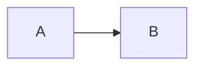

# Static portfolio and blog (v2)

A fast static site generated from the GitLab/Obsidian content repository. The browser receives semantic HTML, CSS, and small vanilla JavaScript modules. Runtime writes (comments, likes, leaderboard) go back into the same vault via server-side GitLab APIs — no Supabase or other database.

## Local preview

```bash
npm install
npm run dev
```

`npm run dev` uses built-in demo content, so GitLab credentials are not required.

## Tests

```bash
npm test
```

Uses Node’s built-in test runner (`node:test`). Content-repo review tests:

```bash
cd ../blog
python -m unittest tests/test_process_review.py
```

## Production build

Copy `.env.example` to `.env`. Required:

- `GITLAB_PROJECT_ID`
- `GITLAB_TOKEN` — **read + write** on the content project (`api` scope, or `read_repository` + `write_repository`). Server-only; do not use `NEXT_PUBLIC_*` for a write token.
- `GITLAB_REF` (defaults to `main`)
- `SITE_URL`
- `GITLAB_WEBHOOK_SECRET` / `VERCEL_DEPLOY_HOOK_URL` (CMS auto-rebuild)

Optional:

- `SITE_CACHE_REF` (default `site-cache`) — branch for prior HTML used by incremental builds
- `SKIP_SITE_CACHE=1` — skip uploading cache during build

```bash
npm run build
```

Output is `dist/`.

## Vercel

- **Root Directory:** repository root
- **Build Command:** `npm run build`
- **Output Directory:** `dist`
- Env vars: same as `.env.example` (token stays on the server / build)

## Content format (GitLab vault)

- `content.json` — portfolio, projects, social links
- `details.json` / `pages/` / `tags/` — listings
- post `*.md` — YAML front matter + markdown
- `comments/approved/{slug}.json` — published comments
- `likes/{slug}.json` — like counts + device ids
- `leaderboard.json` — type-race scores
- `rebuild-manifest.json` — dirty posts / comment pages / full flag
- `Review/` — Obsidian inbox for moderation

### Obsidian review loop

1. Open `Review/Home.md`
2. Open a pending note under `Review/Pending/`
3. Set frontmatter `decision:` to `accept` or `reject`
4. Commit & push with Obsidian Git

Pre-commit runs `process_review.py` then `generate_repo_structure.py`.

### Mermaid and charts

In any post:

````markdown


```chart
{ "type": "bar", "data": { "labels": ["a"], "datasets": [{ "data": [1] }] } }
```
````

### Rebuild manifest

- `full: true` → fetch and regenerate everything
- Otherwise the build reuses HTML from the `site-cache` branch for unchanged posts and only re-fetches dirty markdown
- After a successful production build, processed entries are cleared with a `[skip rebuild]` commit

## Runtime architecture

| Endpoint | Role |
|----------|------|
| `POST /api/comments` | Create `Review/Pending/*.md` |
| `GET/POST /api/likes` | Read/write `likes/{slug}.json` (one like per device id) |
| `POST /api/leaderboard` | Append to `leaderboard.json` |
| `POST /api/content-webhook` | GitLab push → Vercel deploy (skips `[skip rebuild]`) |

The GitLab token never ships to the browser. Client JS only calls `/api/*`.

## Auto-update when CMS content changes

1. Vercel → **Settings** → **Git** → **Deploy Hooks** → create `cms-rebuild`
2. Set `VERCEL_DEPLOY_HOOK_URL` and `GITLAB_WEBHOOK_SECRET` on Vercel
3. GitLab content project → **Webhooks** → `https://anasmerstani.com/api/content-webhook` with the same secret, **Push events**

```
CMS push (no [skip rebuild]) → /api/content-webhook → Vercel Deploy Hook → rebuild
```

Runtime commits (likes, pending comments, leaderboard, manifest clear, site-cache) include `[skip rebuild]` and do not redeploy.
